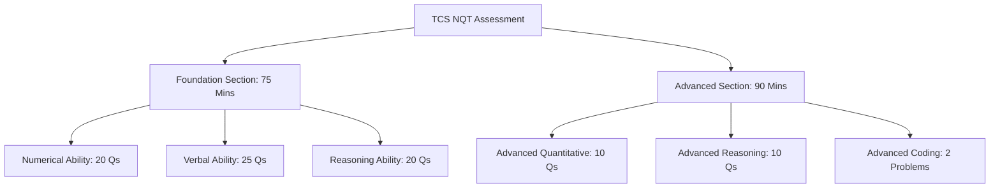

# Company Hiring Playbook: Tata Consultancy Services (TCS Digital / Prime)

**Role Target**: Systems Engineer (Digital / Prime Cadre)  
**Typical CTC Range**: ₹7.0 - ₹11.5 LPA  
**Interview Rounds**: TCS National Qualifier Test (NQT) $\rightarrow$ Technical Interview $\rightarrow$ Managerial & HR Interview

---

## 1. Overview of TCS Digital & Prime Tracks

TCS offers tiered campus hiring packages through its National Qualifier Test:
- **TCS Ninja**: Standard cadre (₹3.36 - ₹3.6 LPA).
- **TCS Digital**: Premium cadre (₹7.0 - ₹7.5 LPA) — awarded to top percentile NQT performers.
- **TCS Prime**: Elite cadre (₹9.0 - ₹11.5 LPA) — introduced for high-performing coders with advanced algorithmic mastery.

---

## 2. TCS NQT Exam Structure & Pattern

The TCS NQT is divided into two major sections: **Cognitive Skills** and **Advanced Technical Skills**.

### Advanced Coding Requirements:
- **Problem 1 (Medium)**: 25 minutes. String transformations, hashing, modular arithmetic, array manipulation.
- **Problem 2 (Medium-Hard)**: 35 minutes. Dynamic programming, graph traversal, greedy interval scheduling, prefix sums.
- **Passing Threshold for Digital**: 100% test cases passed on Problem 1 and $\ge 80\%$ on Problem 2 (including private performance test cases).

---

## 3. High-Frequency Interview Topics

### Technical Interview (45–60 Minutes)
- **Core Engineering Concepts**:
  - OOPs: Real-world analogies for Polymorphism and Encapsulation.
  - DBMS: ACID properties, difference between Clustered and Non-Clustered Indexes, complex `GROUP BY` and `HAVING` queries.
  - Operating Systems: Deadlock conditions (Mutual Exclusion, Hold & Wait, No Preemption, Circular Wait), Paging vs. Segmentation.
  - Computer Networks: Three-way TCP Handshake, DNS resolution flow, HTTPS TLS handshakes.
- **Project Walkthrough**:
  - Detailed explanation of final-year engineering projects.
  - Architecture explanation, database design, API design, and deployment choices.

### Managerial & HR Round (20–30 Minutes)
- Situational scenarios: Working under tight project deadlines, conflict resolution in team projects.
- Flexibility regarding relocation, shift work, and continuous re-skilling in emerging technologies (Cloud, GenAI, Cyber Security).

---

## 4. High-Yield Practice Checklist

| Category | Problem / Topic | Key Concept |
| :--- | :--- | :--- |
| **Mathematics & Logic** | Sieve of Eratosthenes, Prime Factorization | Sub-linear primality checks ($O(\sqrt{n})$) |
| **Arrays & Hashing** | Longest Substring Without Repeating Characters | Sliding window with hash set |
| **Dynamic Programming** | Coin Change / Minimum Steps to 1 | Memoized state transitions ($dp[i] = \min(dp[i-c]) + 1$) |
| **SQL Queries** | Find $N^{\text{th}}$ Highest Salary | Subquery or `DENSE_RANK() OVER (ORDER BY salary DESC)` |
| **Core CS** | Process vs. Thread & Context Switching | Thread shared memory vs. process isolated memory |

