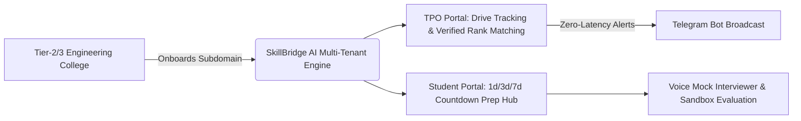
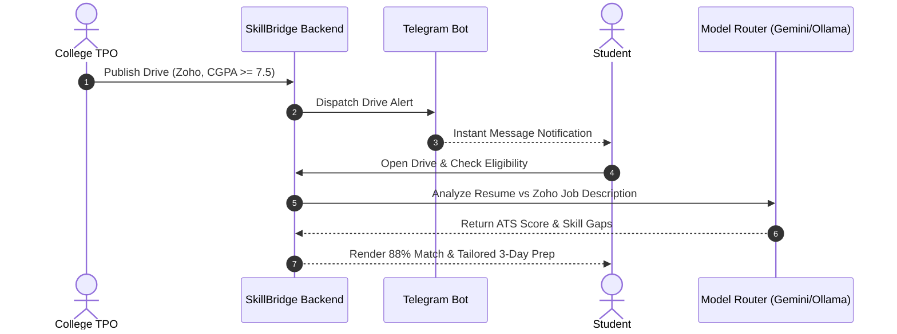

# SkillBridge AI — Product Requirements Document (PRD)

**Document Reference**: `SB-DOC-01`  
**Version**: 1.0.0  
**Target Audience**: Engineering Leads, Product Designers, TPO Administrators, Academic Stakeholders  
**Product Cost**: 100% Free (₹0 Operational Cost via Free-Tier Cloud & Local Ollama Inference)

---

## 1. Executive Summary & Vision

Tier-2 and Tier-3 engineering colleges across India graduate over 1.2 million engineers annually. Over 78% of these students lack structured placement guidance, access to high-priced mock interview platforms (such as InterviewBit or LeetCode Premium), and tailored corporate preparation. Meanwhile, Training & Placement Officers (TPOs) struggle with manual spreadsheet tracking, unverified student resumes, poor drive attendance, and chaotic WhatsApp communication channels.

**SkillBridge AI** is an open-source, multi-tenant career preparation and placement automation operating system. It provides an institutional portal for colleges and a personalized career hub for students, offering AI-driven resume scoring, countdown-based preparation hubs, simulated voice interviews, and sandboxed coding assessments — at zero platform cost to institutions and students.

---

## 2. Target Personas & Problem Scenarios

### Persona 1: Suresh Kannan (Final-Year B.Tech Student)
- **Background**: CSE student at an affiliated regional college; eligible for upcoming TCS Digital and Zoho drives.
- **Pain Points**:
  - Unclear why his resume gets rejected at ATS screening rounds.
  - Anxious about technical live coding and behavioral English rounds.
  - Cannot afford ₹3,000–₹10,000 commercial interview coaching packages.
- **SkillBridge Solution**:
  - Instant ATS semantic parsing against live drive job descriptions.
  - Personalized 1-day, 3-day, and 7-day revision sprints tailored to the specific visiting company.
  - Zero-cost interactive voice mock interviews with live speech-to-text and instant scoring.

### Persona 2: Dr. Malathi Ramanathan (Placement Officer - TPO)
- **Background**: TPO managing placements for 1,400 eligible students across 6 departments.
- **Pain Points**:
  - Cross-referencing eligibility criteria (CGPA, active backlogs, departmental restrictions) across massive Excel files takes days.
  - Drive updates sent via WhatsApp groups get buried under chat spam.
  - Inability to gauge if registered students are actually practicing for interview rounds.
- **SkillBridge Solution**:
  - One-click drive creation with automated student matching and ranking.
  - Audit-ready analytics dashboard showing student preparation readiness.
  - One-click Telegram channel broadcasting with markdown alerts and direct RSVP links.

---

## 3. Product Scope & Functional Modules

| Module ID | Module Name | Primary Stakeholder | Key Capabilities |
| :--- | :--- | :--- | :--- |
| **MOD-01** | **Multi-Tenant College Isolation** | SuperAdmin / TPO | Custom slug URLs (`anna-univ.skillbridge.edu`), isolated tenant schemas, white-labeled college badges. |
| **MOD-02** | **TPO Drive Command Center** | TPO | Campus drive publishing, automated candidate ranking, exportable shortlists, Telegram broadcast dispatch. |
| **MOD-03** | **Student Career Hub** | Student | Profile management, academic metrics tracker, personalized drive listings, target skill matrices. |
| **MOD-04** | **AI Resume ATS & Skill Gap Analyzer** | Student | PDF/text extraction, ATS compatibility score (0-100), missing keyword detection, actionable resume recommendations. |
| **MOD-05** | **Company Countdown Prep Hub** | Student | 7-day comprehensive, 3-day accelerated, and 1-day intensive study roadmaps mapped to company playbooks (e.g. Amazon, Zoho, TCS). |
| **MOD-06** | **Voice Mock Interview Simulator** | Student | Multi-turn speech-to-text (Web Speech API) and text-to-speech audio interviews with instant performance scorecards. |
| **MOD-07** | **In-Browser Coding Sandbox** | Student | Sandboxed execution for Python and JavaScript algorithms with test case verification and execution metrics. |
| **MOD-08** | **Zero-Cost Model Router Engine** | Core Platform | Dynamic routing across Gemini 1.5 Flash, Groq, OpenRouter, and local offline Ollama models. |

---

## 4. Key User Journeys

### User Journey 1: Campus Drive Application & Preparation
1. **Drive Publication**: TPO creates a new drive for "Zoho Corporation - Software Developer" with criteria: CGPA $\ge 7.5$, CSE/IT/ECE, CTC: ₹8.5 LPA.
2. **Instant Notification**: System broadcasts drive details to the college Telegram channel and student dashboard.
3. **Student Match Check**: Student logs in; system computes an instant 88% Match Score based on student CGPA and indexed resume skills.
4. **Targeted Preparation**: Student enters the **Zoho Prep Hub**, unlocks the 3-day sprint (focusing on C/Java pointers, matrix algorithms, and OOP system design).
5. **Interview Simulation**: Student completes a 5-question voice technical interview and gets a feedback scorecard with a 4.2/5.0 communication rating.

---

## 5. Non-Functional Requirements (NFRs)

### Performance & Latency
- **API Response Time**: P95 $< 180\text{ms}$ for non-AI database queries.
- **AI Streaming / First-Token Latency**: P95 $< 1.2\text{s}$ via Groq/Gemini Flash free-tier APIs; $< 2.5\text{s}$ on local Ollama 7B models.
- **Sandbox Execution Limit**: Hard ceiling of $4.0\text{s}$ CPU time and $64\text{MB}$ memory consumption per student script.

### Scalability & Tenancy
- Capable of sustaining 5,000 concurrent students per college node during peak placement drives.
- Zero data leakage across college boundaries via strict tenant foreign-key scoping and tenant-aware JWT validation.

### Cost & Availability Constraints
- **Target Cost**: ₹0 base operating expense (Free-tier hosting on Render/Fly.io + Vercel, Supabase Free Tier or local SQLite, Free AI APIs + local Ollama fallback).
- **Offline Resilience**: Student preparation and interview simulation remain fully operational even if public internet connectivity drops, via local Ollama inference.

