# SkillBridge AI — System Architecture Specification
## Document 2: Complete Architectural Blueprint

---

## 1. Architectural Overview & System Topology

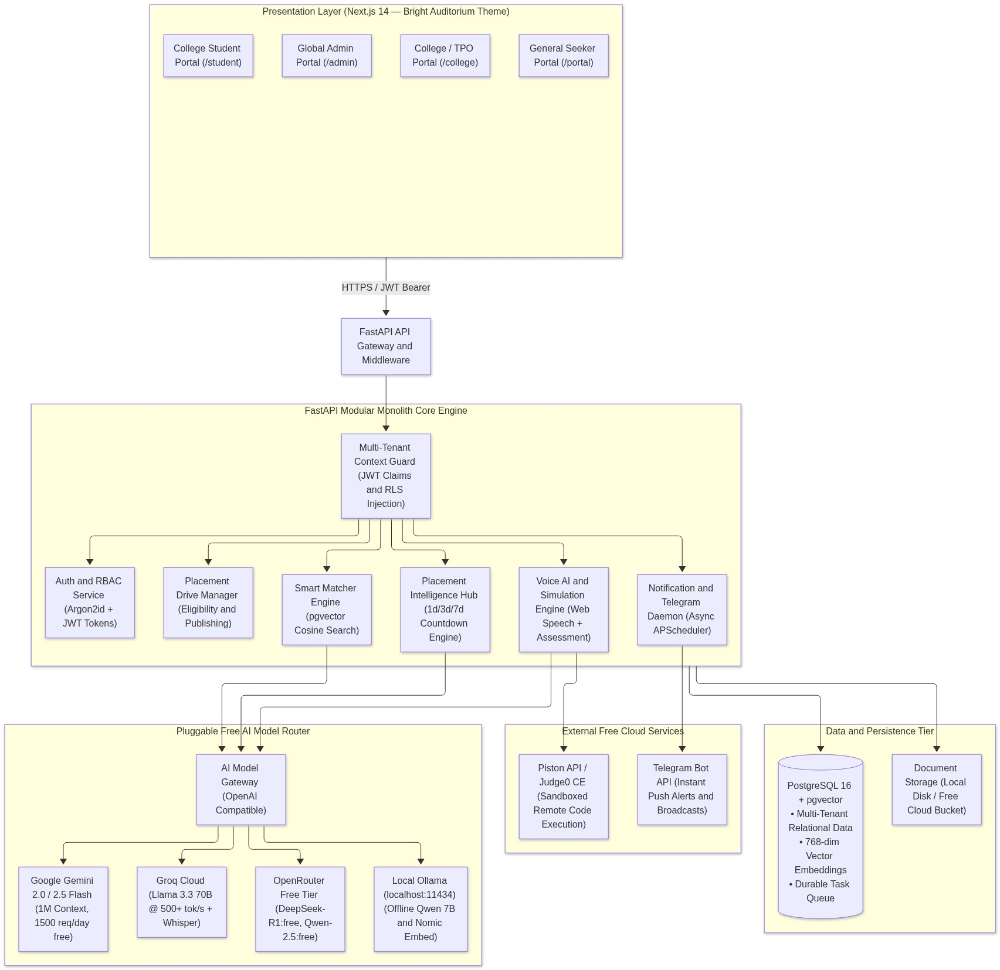

**SkillBridge AI** is architected as an **AI-First Modular Monolith** with a decoupled **Next.js 14 Frontend** and an asynchronous **Python FastAPI Backend**, backed by **PostgreSQL 16 with `pgvector`**.

The platform is designed around four foundational invariants:
1. **100% Free Operational Footprint**: Engineered entirely on high-capacity cloud free tiers (Gemini Flash, Groq, Piston API, Telegram Bot API) and local open-source models (Ollama).
2. **Zero-Hallucination Job Verification**: AI agents are strictly forbidden from generating synthetic job openings or external application links. Every job listing carries cryptographic or source attribution.
3. **Rigid College-Level Multi-Tenancy**: Complete data isolation across institutions via PostgreSQL Row-Level Security (RLS) and cryptographic tenant context injection.
4. **Hermes-Inspired Multi-Agent Engine**: Strict separation of Orchestrator agents from Leaf subagents, durable task queuing via PostgreSQL row-level locks, and byte-stable prompt caching.

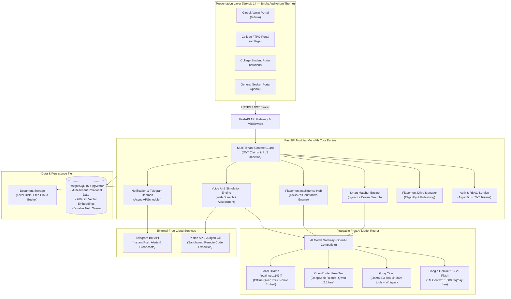

---

## 2. Presentation Layer Architecture (Frontend)

* **Framework**: **Next.js 14 (App Router) + TypeScript**.
* **Styling**: **Tailwind CSS + Shadcn UI** (Radix UI primitives).
* **Visual Direction**: **"Bright Auditorium Light Mode"**:
  * Backgrounds: Crisp White (`#FFFFFF`) and Slate-50 (`#F8FAFC`).
  * Text & Headings: High-contrast Slate-900 (`#0F172A`) and Slate-700 (`#334155`).
  * Accent Colors: Indigo-600 (`#4F46E5`) for primary actions and Violet-500 (`#8B5CF6`) for AI intelligence widgets.
  * Card Elements: Clean 1px Slate-200 borders, minimal 2px soft shadows, zero blurry glassmorphism.

### Portal Routing Structure

```
src/app/
├── (auth)/
│   ├── login/                     # Role-based unified login
│   ├── register/                  # Student & General Seeker registration
│   └── college-onboard/           # College onboarding request
├── (portals)/
│   ├── admin/                     # Global Admin Portal
│   │   ├── colleges/              # College management & onboarding approvals
│   │   ├── job-feeds/             # External feed monitors & scrapers
│   │   └── analytics/             # System-wide placement statistics
│   ├── college/                   # College / TPO Portal (Tenant Isolated)
│   │   ├── dashboard/             # College-level placement dashboard
│   │   ├── departments/           # CSE, ECE, Mech department management
│   │   ├── drives/                # Placement drive creation & criteria setup
│   │   ├── students/              # Enrolled students & readiness leaderboard
│   │   └── telegram-broadcast/    # Broadcast drives to student Telegram channels
│   ├── student/                   # College Student Portal (The AI Hub)
│   │   ├── dashboard/             # Upcoming eligible drives & countdown timers
│   │   ├── resume/                # AI Resume Parser & ATS scoring
│   │   ├── placement-hub/         # 1-day, 3-day, 7-day Preparation Sprints
│   │   ├── interview/             # Real-time Voice Mock Interviewer
│   │   ├── simulation/            # Full drive simulation (MCQ + Coding Sandbox)
│   │   └── settings/              # Telegram account pairing & AI provider toggle
│   └── portal/                    # General Job Seeker Portal
│       ├── search/                # Filtered job discovery
│       └── my-applications/       # Status tracker
└── api/                           # Next.js API routes (BFF / proxying to FastAPI)
```

---

## 3. Backend Architecture (FastAPI Modular Monolith)

The backend is organized as a **Modular Monolith** inside Python 3.11 FastAPI. This gives the team the clean domain separation of microservices without the operational nightmare of separate network deployments.

```
backend/
├── app/
│   ├── main.py                    # FastAPI entry point, CORS, lifespan handlers
│   ├── core/
│   │   ├── config.py              # Pydantic Settings (ENV variables)
│   │   ├── database.py            # Async engine, sessionmaker (SQLModel / SQLAlchemy)
│   │   ├── security.py            # Argon2id password hashing, JWT token creation
│   │   └── tenant.py              # Tenant context dependency (college_id extractor)
│   ├── models/                    # SQLModel database tables & Pydantic DTOs
│   │   ├── college.py             # College, Department entities
│   │   ├── user.py                # User, Role, Permissions entities
│   │   ├── student.py             # StudentProfile, AcademicRecord entities
│   │   ├── drive.py               # PlacementDrive, EligibilityCriteria entities
│   │   ├── prep_hub.py            # CountdownPlan, StudyTopic, MCQ entities
│   │   ├── interview.py           # MockInterviewSession, TurnRecord entities
│   │   └── queue.py               # AsyncAgentTask (Kanban task queue)
│   ├── api/v1/                    # REST API route handlers
│   │   ├── auth.py                # Login, refresh tokens, register
│   │   ├── colleges.py            # TPO operations & department CRUD
│   │   ├── drives.py              # Placement drive management
│   │   ├── students.py            # Student profiles & applications
│   │   ├── resume.py              # PDF upload & ATS extraction
│   │   ├── prep_hub.py            # 1d/3d/7d countdown generation
│   │   ├── interview.py           # Voice mock interview streaming
│   │   ├── simulation.py          # Coding evaluation (Piston API proxy)
│   │   └── telegram.py            # Telegram bot webhook handler
│   ├── ai/                        # The Multi-Agent & LLM Engine
│   │   ├── router.py              # OpenAI-compatible Multi-Provider Gateway
│   │   ├── prompts/               # Byte-stable system prompts & evaluation rubrics
│   │   ├── agents/
│   │   │   ├── orchestrator.py    # Placement Preparation Planning Orchestrator
│   │   │   ├── resume_leaf.py     # PDF to JSON extractor
│   │   │   ├── gap_leaf.py        # Resume vs JD semantic similarity matcher
│   │   │   └── interview_leaf.py  # Mock interview question generator & evaluator
│   │   └── playbooks/             # Company Markdown skills (TCS, Amazon, Zoho)
│   └── workers/                   # Asynchronous background runners
│       ├── scheduler.py           # APScheduler cron daemon (Telegram alerts)
│       └── task_consumer.py       # PostgreSQL SKIP LOCKED task worker
└── pyproject.toml                 # Dependencies managed via uv / pip
```

---

## 4. Multi-Tenant College Isolation Model

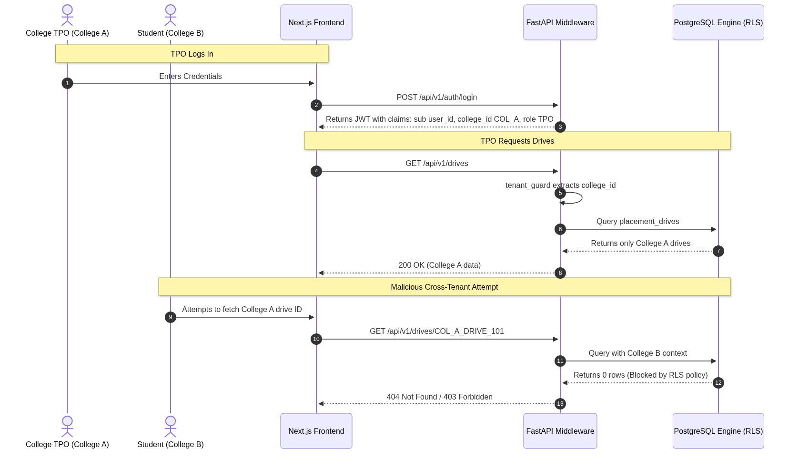

```mermaid
sequenceDiagram
    autonumber
    actor TPO as College TPO (College A)
    actor Stu as Student (College B)
    participant Client as Next.js Frontend
    participant API as FastAPI Middleware
    participant PG as PostgreSQL Engine (RLS)

    Note over TPO,Client: TPO Logs In
    TPO->>Client: Enters Credentials
    Client->>API: POST /api/v1/auth/login
    API-->>Client: Returns JWT with claims: {sub: user_id, college_id: "COL_A", role: "TPO"}
    
    Note over Client,PG: TPO Requests Drives
    Client->>API: GET /api/v1/drives (Authorization: Bearer <JWT>)
    API->>API: tenant_guard extracts college_id = "COL_A"
    API->>PG: SET LOCAL app.current_tenant = 'COL_A'; SELECT * FROM placement_drives;
    PG-->>API: Returns only College A drives (enforced by RLS)
    API-->>Client: 200 OK (College A data)

    Note over Stu,PG: Malicious / Cross-Tenant Attempt
    Stu->>Client: Attempts to fetch College A drive ID
    Client->>API: GET /api/v1/drives/COL_A_DRIVE_101 (JWT has college_id: "COL_B")
    API->>PG: SET LOCAL app.current_tenant = 'COL_B'; SELECT * FROM placement_drives WHERE id = 'COL_A_DRIVE_101';
    PG-->>API: Returns 0 rows (Blocked by RLS policy)
    API-->>Client: 404 Not Found / 403 Forbidden
```

### PostgreSQL Row-Level Security Policy Implementation
```sql
-- 1. Enable RLS on Tenant-sensitive tables
ALTER TABLE students ENABLE ROW LEVEL SECURITY;
ALTER TABLE placement_drives ENABLE ROW LEVEL SECURITY;
ALTER TABLE applications ENABLE ROW LEVEL SECURITY;

-- 2. Define Tenant Isolation Policies
CREATE POLICY tenant_isolation_drives ON placement_drives
    FOR ALL
    USING (college_id = NULLIF(current_setting('app.current_tenant', true), '')::uuid);

CREATE POLICY tenant_isolation_students ON students
    FOR ALL
    USING (college_id = NULLIF(current_setting('app.current_tenant', true), '')::uuid);
```

---

## 5. Hermes-Inspired Multi-Agent Engine

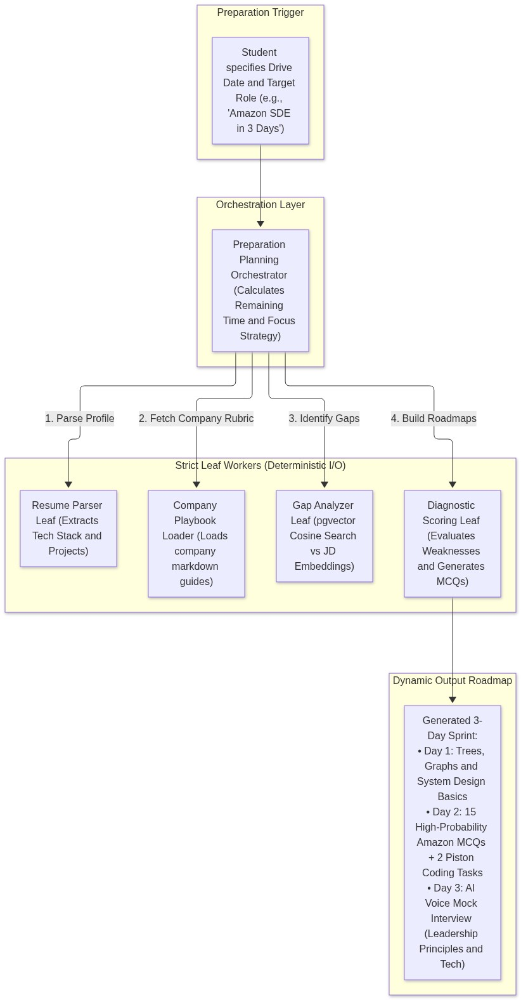

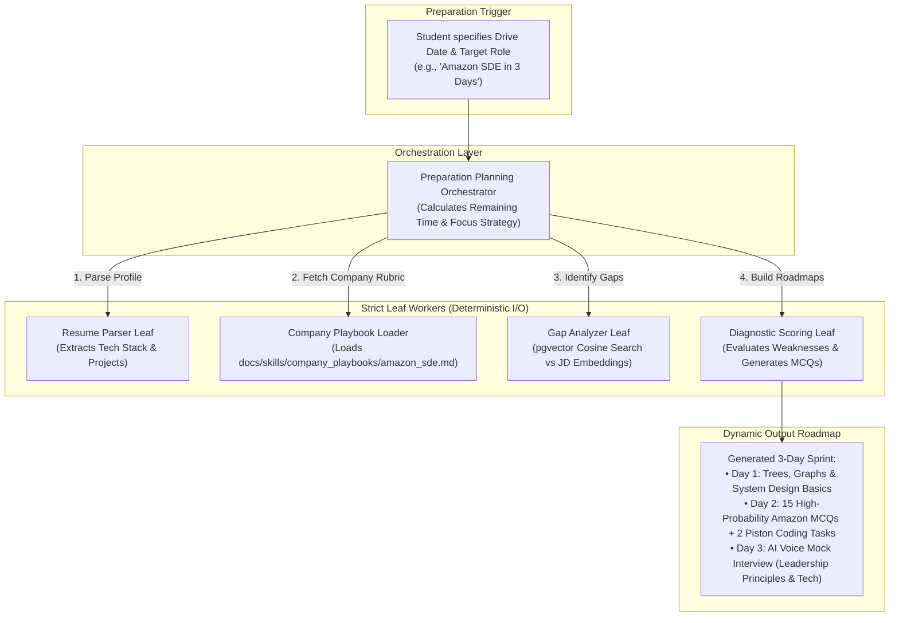

### Durable Task Queue (PostgreSQL SKIP LOCKED Pattern)
To handle background tasks (batch resume processing, periodic external job collection, scheduled Telegram alerts) without message brokers like RabbitMQ or Celery:
```sql
-- Worker retrieves and locks next available task atomically
WITH next_task AS (
    SELECT id FROM async_agent_tasks
    WHERE status = 'PENDING' AND scheduled_at <= CURRENT_TIMESTAMP
    ORDER BY priority DESC, created_at ASC
    LIMIT 1
    FOR UPDATE SKIP LOCKED
)
UPDATE async_agent_tasks
SET status = 'RUNNING', started_at = CURRENT_TIMESTAMP
FROM next_task
WHERE async_agent_tasks.id = next_task.id
RETURNING async_agent_tasks.*;
```
* **Failure Circuit Breaker**: If `retry_count >= 2`, status transitions permanently to `FAILED` and an alert is logged, preventing token-burning loops.

---

## 6. Pluggable Free AI Model Gateway

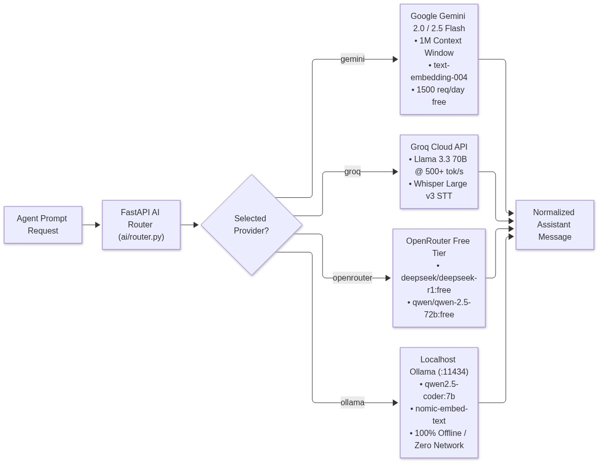

The application integrates an OpenAI-compatible model router that can seamlessly toggle between free cloud providers and local offline inference:

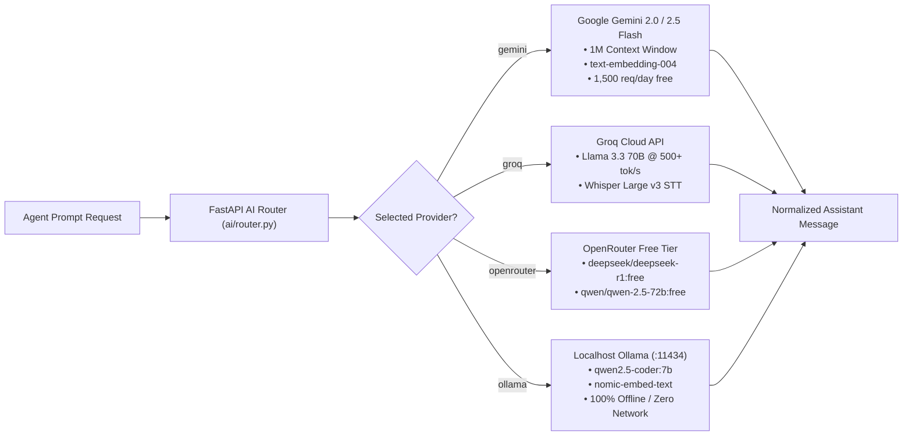

* **Automatic Failover**: If Gemini hits a transient HTTP 429 (rate limit), the router automatically re-routes to Groq Cloud (`llama-3.3-70b-versatile`) without throwing an error to the user.

---

## 7. Database Architecture & Vector Embeddings

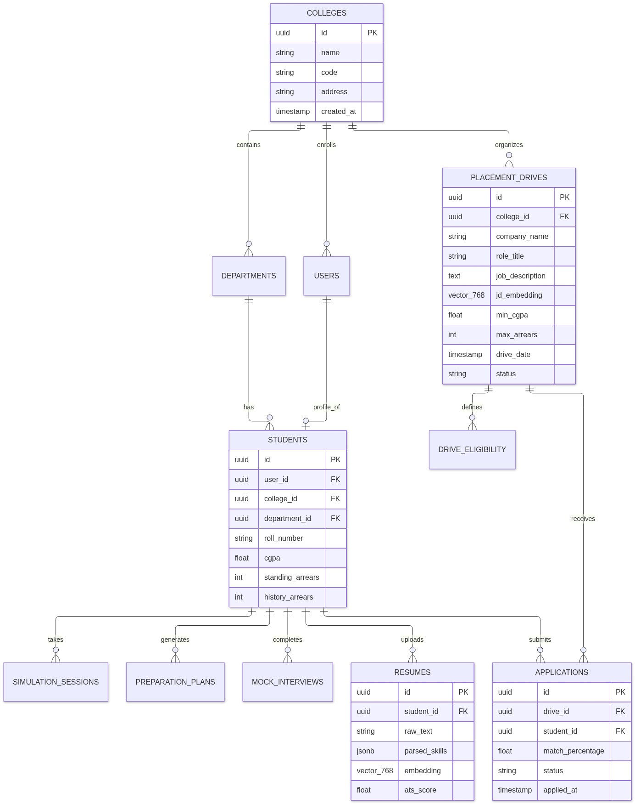

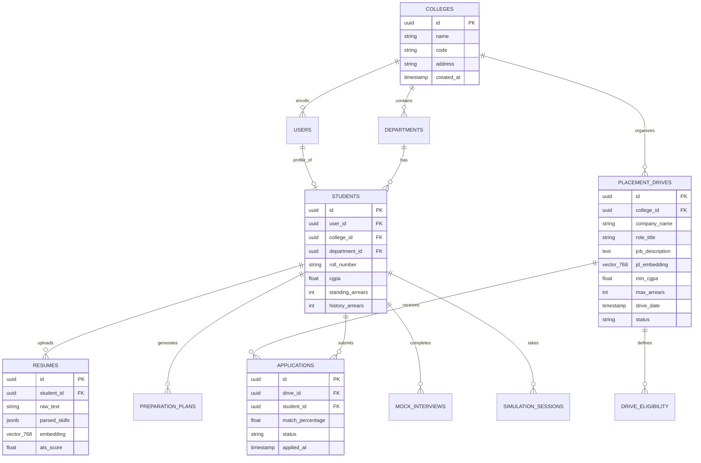

### Vector Search Indexing (`pgvector`)
Resumes and Job Descriptions are stored as 768-dimensional vectors using `pgvector`. Similarity matching queries use Hierarchical Navigable Small World (**HNSW**) indexes for sub-millisecond retrieval:
```sql
CREATE INDEX idx_resumes_embedding ON resumes 
USING hnsw (embedding vector_cosine_ops) 
WITH (m = 16, ef_construction = 64);

CREATE INDEX idx_drives_jd_embedding ON placement_drives 
USING hnsw (jd_embedding vector_cosine_ops) 
WITH (m = 16, ef_construction = 64);
```

---

## 8. Voice Mock Interview & Code Execution Engine

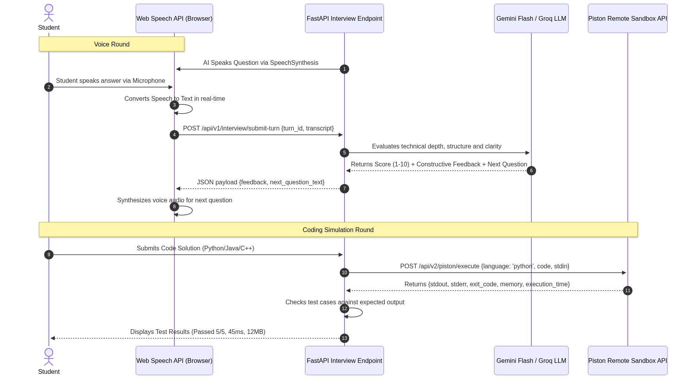

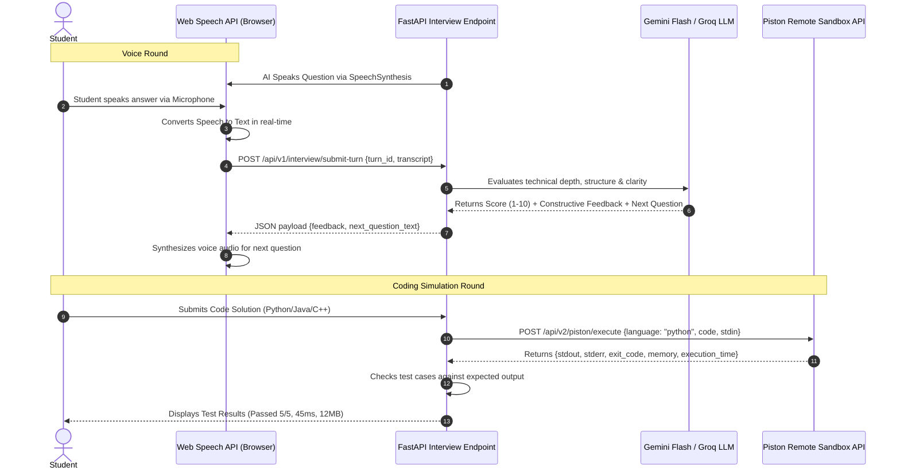

---

## 9. Notification & Telegram Bot Architecture

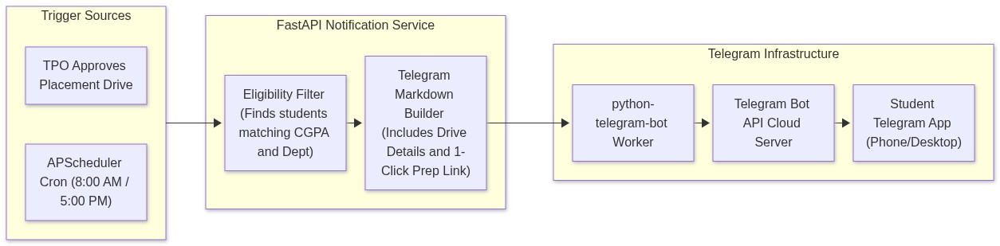

```mermaid
flowchart LR
    subgraph Trigger["Trigger Sources"]
        TPOEvent["TPO Approves Placement Drive"]
        CronTick["APScheduler Cron (8:00 AM / 5:00 PM)"]
    end

    subgraph Service["FastAPI Notification Service"]
        MatchFilter["Eligibility Filter<br/>(Finds students matching CGPA & Dept)"]
        MsgBuilder["Telegram Markdown Builder<br/>(Includes Drive Details & 1-Click Prep Link)"]
    end

    Trigger --> MatchFilter
    MatchFilter --> MsgBuilder

    subgraph TelegramInfra["Telegram Infrastructure"]
        BotDaemon["python-telegram-bot Worker"]
        TelegramCloud["Telegram Bot API Cloud Server"]
        StudentDevice["Student Telegram App (Phone/Desktop)"]
    end

    MsgBuilder --> BotDaemon
    BotDaemon --> TelegramCloud
    TelegramCloud --> StudentDevice
```

* **No SMS/WhatsApp Fees**: 100% free push delivery via Telegram.
* **Instant Account Linking**: Students connect their Telegram by sending `/start <linking_token>` to the bot; FastAPI securely binds their `telegram_chat_id` to their `user_id`.

---

## 10. Free Deployment Topology

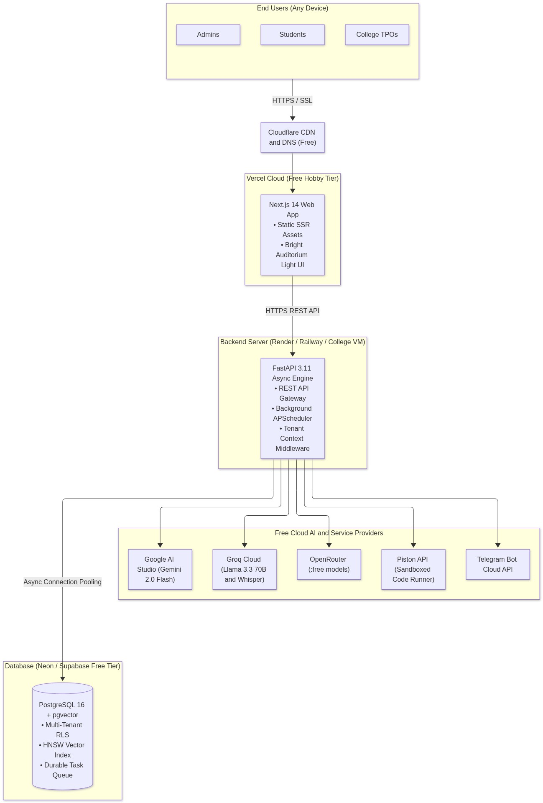

```
┌─────────────────────────────────────────────────────────────────┐
│                        INTERNET USERS                           │
└────────────────────────────────┬────────────────────────────────┘
                                 │
                 ┌───────────────┴───────────────┐
                 │                               │
┌────────────────▼───────────────┐ ┌─────────────▼───────────────┐
│ Vercel Cloud (Free Hobby Tier) │ │ Cloudflare DNS / CDN (Free) │
│ • Next.js 14 Frontend          │ │ • HTTPS SSL Termination     │
│ • Static Assets & SSR          │ │ • DDoS Shield               │
└────────────────┬───────────────┘ └─────────────┬───────────────┘
                 │                               │
                 └───────────────┬───────────────┘
                                 │ HTTPS / REST
┌────────────────────────────────▼────────────────────────────────┐
│ Backend Compute (Render / Railway Free Tier / College Lab VM)   │
│ • Python 3.11 FastAPI Async Server                              │
│ • In-Process APScheduler Telegram Worker                        │
└────────────────┬───────────────────────────────┬────────────────┘
                 │                               │
┌────────────────▼───────────────┐ ┌─────────────▼───────────────┐
│ Neon / Supabase (Free Tier)    │ │ External Free APIs          │
│ • PostgreSQL 16                │ │ • Google AI Studio (Gemini) │
│ • pgvector Vector Index        │ │ • Groq Cloud (Llama 70B)    │
│ • Automated Backups            │ │ • Piston API (Code Sandbox) │
│                                │ │ • Telegram Bot API          │
└────────────────────────────────┘ └─────────────────────────────┘
```

---

## 11. Architectural Summary & Verification Checklist

| Quality Attribute | Architectural Solution | Verification Method |
| :--- | :--- | :--- |
| **Multi-Tenant Security** | PostgreSQL Row-Level Security + JWT `college_id` claim injection. | Cross-tenant automated PyTest queries. |
| **Operational Cost** | Gemini Flash Free Tier + Groq + Piston API + Web Speech API. | Zero credit-card requirement verification. |
| **Performance** | FastAPI async I/O + pgvector HNSW index. | Sub-100ms vector search response time. |
| **Voice Latency** | Client-side Web Speech API audio processing. | Zero network audio transmission lag. |
| **Code Execution Safety** | Remote Piston API cloud sandbox. | Malicious infinite loop isolation test. |
| **Reliability** | PostgreSQL `FOR UPDATE SKIP LOCKED` task queue. | Process kill & restart recovery test. |

