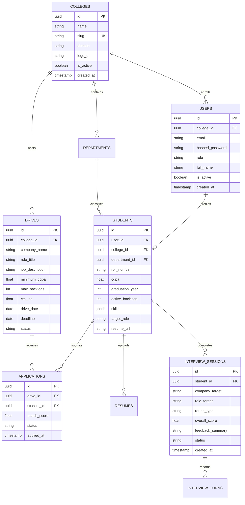

# SkillBridge AI — Database Architecture & Schema Specification

**Document Reference**: `SB-DOC-03`  
**Version**: 1.0.0  
**Storage Engines**: SQLite (Development & Local Offline) / PostgreSQL 15+ with `pgvector` (Production)

---

## 1. Entity-Relationship Model (ERD)



---

## 2. Data Dictionary & Table Definitions

### 2.1 `colleges` (Tenant Root Entity)
| Column | Type | Constraints | Description |
| :--- | :--- | :--- | :--- |
| `id` | `VARCHAR(36)` | PK | UUID v4 unique tenant identifier |
| `name` | `VARCHAR(255)` | NOT NULL | Full institution name (e.g. Anna University CEG) |
| `slug` | `VARCHAR(100)` | UNIQUE, NOT NULL, INDEX | Subdomain identifier (e.g. `anna-univ`) |
| `domain` | `VARCHAR(100)` | NULLABLE | Institutional email domain filter (`ceg.annauniv.edu`) |
| `logo_url` | `VARCHAR(500)` | NULLABLE | CDN or local static URL to institution crest |
| `is_active` | `BOOLEAN` | DEFAULT TRUE | Account operational status |
| `created_at` | `DATETIME` | DEFAULT UTC NOW | Creation timestamp |

### 2.2 `users` (Identity & RBAC)
| Column | Type | Constraints | Description |
| :--- | :--- | :--- | :--- |
| `id` | `VARCHAR(36)` | PK | UUID v4 unique user identifier |
| `college_id` | `VARCHAR(36)` | FK -> `colleges.id`, INDEX | Enforcing multi-tenant isolation |
| `email` | `VARCHAR(255)` | NOT NULL, INDEX | User login email (unique per college) |
| `hashed_password` | `VARCHAR(255)` | NOT NULL | Argon2 / bcrypt hashed password string |
| `role` | `VARCHAR(50)` | NOT NULL | Enum: `SUPERADMIN`, `TPO_ADMIN`, `STUDENT`, `RECRUITER` |
| `full_name` | `VARCHAR(150)` | NOT NULL | Display name |
| `is_active` | `BOOLEAN` | DEFAULT TRUE | Login entitlement flag |
| `created_at` | `DATETIME` | DEFAULT UTC NOW | Account creation timestamp |

### 2.3 `students` (Candidate Profile)
| Column | Type | Constraints | Description |
| :--- | :--- | :--- | :--- |
| `id` | `VARCHAR(36)` | PK | UUID v4 identifier |
| `user_id` | `VARCHAR(36)` | FK -> `users.id`, UNIQUE | 1:1 relationship with user account |
| `college_id` | `VARCHAR(36)` | FK -> `colleges.id`, INDEX | Tenant scope foreign key |
| `department_id` | `VARCHAR(36)` | FK -> `departments.id` | Academic branch classification |
| `roll_number` | `VARCHAR(50)` | NOT NULL, INDEX | University registration / register number |
| `cgpa` | `FLOAT` | NOT NULL | Academic cumulative grade point average (0.0 - 10.0) |
| `graduation_year` | `INTEGER` | NOT NULL | Target year of course completion |
| `active_backlogs` | `INTEGER` | DEFAULT 0 | Count of current uncleared backlogs |
| `skills` | `JSON` | DEFAULT '[]' | Extracted array of technical and core competencies |
| `target_role` | `VARCHAR(150)` | NULLABLE | Preferred job role (e.g. SDE-1, Cloud Engineer) |

### 2.4 `drives` (Campus Placement Opportunities)
| Column | Type | Constraints | Description |
| :--- | :--- | :--- | :--- |
| `id` | `VARCHAR(36)` | PK | UUID v4 identifier |
| `college_id` | `VARCHAR(36)` | FK -> `colleges.id`, INDEX | Tenant isolation foreign key |
| `company_name` | `VARCHAR(200)` | NOT NULL | Organization name (e.g. Zoho Corporation) |
| `role_title` | `VARCHAR(200)` | NOT NULL | Position offered |
| `job_description`| `TEXT` | NOT NULL | Raw JD text used for AI skill vector comparison |
| `minimum_cgpa` | `FLOAT` | DEFAULT 0.0 | Hard academic eligibility threshold |
| `max_backlogs` | `INTEGER` | DEFAULT 0 | Allowed backlogs cutoff |
| `ctc_lpa` | `FLOAT` | NOT NULL | Cost To Company in Lakhs Per Annum (INR) |
| `drive_date` | `DATE` | NOT NULL | Scheduled on-campus or virtual drive date |
| `deadline` | `DATE` | NOT NULL | Student registration cutoff date |
| `status` | `VARCHAR(50)` | DEFAULT 'UPCOMING' | Enum: `UPCOMING`, `ONGOING`, `COMPLETED`, `CANCELLED` |

---

## 3. Vector Embedding & Hybrid Search (PostgreSQL + pgvector)

In production deployments with PostgreSQL, resume profiles and job descriptions are vectorized for semantic retrieval:

```sql
-- Production Extension
CREATE EXTENSION IF NOT EXISTS vector;

-- Embedding table for Job Descriptions and Student Resumes
CREATE TABLE IF NOT EXISTS skill_embeddings (
    id VARCHAR(36) PRIMARY KEY,
    college_id VARCHAR(36) NOT NULL REFERENCES colleges(id) ON DELETE CASCADE,
    entity_type VARCHAR(20) NOT NULL, -- 'RESUME' or 'JOB_DESCRIPTION'
    entity_id VARCHAR(36) NOT NULL,
    embedding vector(384),            -- 384-dim for nomic-embed-text / MiniLM-L6
    created_at TIMESTAMP WITH TIME ZONE DEFAULT CURRENT_TIMESTAMP
);

-- Cosine Distance HNSW Index for sub-millisecond similarity queries
CREATE INDEX IF NOT EXISTS idx_skill_embeddings_hnsw 
ON skill_embeddings USING hnsw (embedding vector_cosine_ops)
WITH (m = 16, ef_construction = 64);
```

---

## 4. Multi-Tenant Row Level Security (RLS) Policy

To guarantee zero institutional data cross-contamination when using PostgreSQL:

```sql
-- Enable RLS on core entities
ALTER TABLE users ENABLE ROW LEVEL SECURITY;
ALTER TABLE students ENABLE ROW LEVEL SECURITY;
ALTER TABLE drives ENABLE ROW LEVEL SECURITY;
ALTER TABLE applications ENABLE ROW LEVEL SECURITY;

-- Tenant isolation policy based on session variable
CREATE POLICY tenant_isolation_drives ON drives
FOR ALL
USING (college_id = current_setting('app.current_college_id', true));

CREATE POLICY tenant_isolation_students ON students
FOR ALL
USING (college_id = current_setting('app.current_college_id', true));
```
In SQLite mode (dev/local), tenancy is enforced at the repository/query layer via mandatory `col_id: str` parameters extracted from authenticated JWT tokens.

