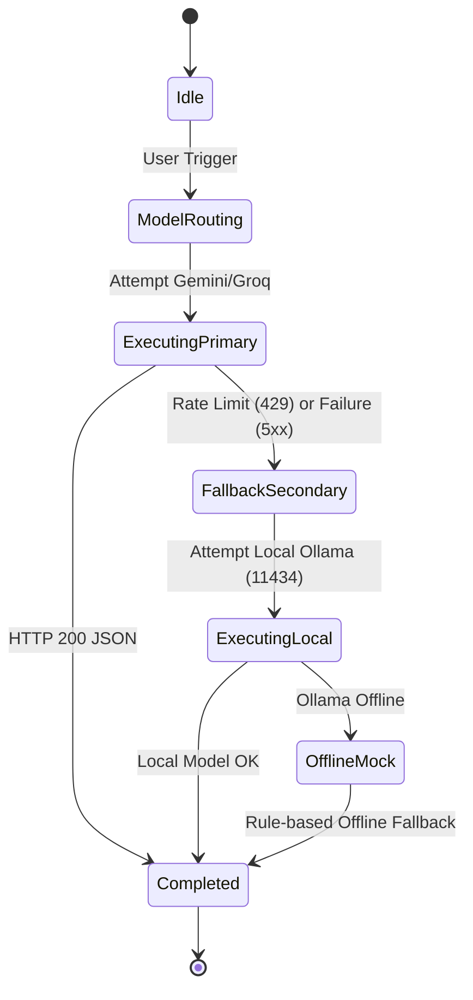

# SkillBridge AI — Autonomous AI Agent System Design

**Document Reference**: `SB-DOC-05`  
**Version**: 1.0.0  
**Architecture Base**: Hermes Agent Leaf-and-Orchestrator Pattern + Dynamic Multi-Provider Routing

---

## 1. Architectural Philosophy

SkillBridge AI adopts the modular agent paradigm established by senior AI agent frameworks (such as the local `Hermes Agent` engine). Rather than relying on a single monolithic, slow LLM prompt, the system separates **Coordinating Orchestrators** from dedicated, deterministic **Leaf Agents**.

```mermaid
graph TD
    Client[Client Request] --> Router{Zero-Cost Model Router}
    
    subgraph Provider Tier
        Router -->|Cloud Tier 1| G[Google Gemini 1.5 Flash]
        Router -->|Cloud Tier 2| GQ[Groq Llama 3.3 70B]
        Router -->|Cloud Tier 3| OR[OpenRouter Free Tier]
        Router -->|Offline / Local| OL[Local Ollama: qwen2.5-coder]
    end
    
    subgraph Agent Coordination
        Orchestrator[Master Placement Orchestrator]
        Orchestrator --> LeafResume[Resume Parsing Leaf Agent]
        Orchestrator --> LeafGap[Skill Gap & Playbook Leaf Agent]
        Orchestrator --> LeafInterview[Voice Interviewer Leaf Agent]
        Orchestrator --> LeafSandbox[Coding Sandbox Evaluator]
    end
    
    Provider Tier --> Orchestrator
```

---

## 2. Zero-Cost Multi-Provider Model Router

To ensure SkillBridge AI operates indefinitely at **₹0 cost**, the backend implements a resilient multi-provider router adhering to the OpenAI `/v1/chat/completions` protocol specification.

### Provider Priority Fallback Chain
$$\text{Request} \longrightarrow \mathbf{Gemini\ 1.5\ Flash} \xrightarrow{\text{quota full}} \mathbf{Groq\ LLaMA\ 3.3} \xrightarrow{\text{quota full}} \mathbf{OpenRouter\ Free} \xrightarrow{\text{offline}} \mathbf{Local\ Ollama\ (Qwen\ 2.5)}$$

```python
# app/ai/router.py conceptual logic
PROVIDERS = [
    {"name": "gemini", "base_url": "https://generativelanguage.googleapis.com/v1beta/openai/", "model": "gemini-1.5-flash"},
    {"name": "groq", "base_url": "https://api.groq.com/openai/v1", "model": "llama-3.3-70b-versatile"},
    {"name": "openrouter", "base_url": "https://openrouter.ai/api/v1", "model": "meta-llama/llama-3.3-70b-instruct:free"},
    {"name": "ollama", "base_url": "http://localhost:11434/v1", "model": "qwen2.5-coder:7b"}
]
```

### Byte-Stable Prompt Caching
To optimize inference latency on token-billed or rate-limited endpoints, system prompts are constructed with byte-level stability. Fixed instructions appear strictly before variable user data, enabling prompt cache hits across multi-turn sessions:
- **Header**: Fixed System Prompt (Cached)
- **Turn Context**: Immutable Company Playbook Reference (Cached)
- **Dynamic Content**: Student Transcript or Current Turn Response

---

## 3. Leaf Agent Specializations

### 3.1 Resume Scoring Leaf Agent (`app/ai/agents/resume_leaf.py`)
- **Responsibility**: Takes raw PDF extracted text and the target job description. Extracts hard skills, soft skills, educational metrics, project complexity, and ATS layout sanity.
- **Output Format**: Strictly validated Pydantic JSON schema (`ATSScoreReport`).
- **Temperature**: $0.1$ (Deterministic scoring).

### 3.2 Skill Gap & Playbook Leaf Agent (`app/ai/agents/gap_leaf.py`)
- **Responsibility**: Cross-references missing skills against pre-indexed company hiring playbooks (e.g. Amazon Leadership Principles, TCS NQT Aptitude, Zoho Low-Level Design).
- **Output**: 1-day, 3-day, and 7-day tactical prep milestones with actionable resources.

### 3.3 Voice Mock Interview Leaf Agent (`app/ai/agents/interview_leaf.py`)
- **Responsibility**: Conducts interactive multi-turn technical and behavioral interviews. Adapts difficulty based on student answers.
- **Evaluation Criteria**: Technical accuracy (50%), Depth of explanation (25%), Communication & clarity (25%).
- **Temperature**: $0.4$ (Natural dialogue variation while maintaining rubric adherence).

### 3.4 Coding Sandbox Evaluator Leaf Agent (`app/ai/agents/sandbox_leaf.py`)
- **Responsibility**: Analyzes code submitted to the sandbox. Checks edge cases, asymptotic time complexity $O(n)$, space complexity $O(1)$, and code readability.

---

## 4. State Management & Error Handling



When all external and local LLM services are temporarily unavailable, the system gracefully falls back to deterministic rule-based evaluation matrices, ensuring zero student downtime during scheduled lab exams or offline placement practice sessions.

