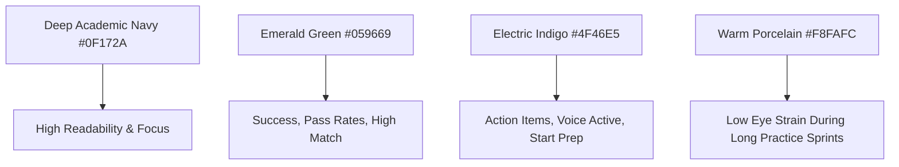

# SkillBridge AI — UI/UX Design System Specification

**Document Reference**: `SB-DOC-06`  
**Theme Name**: "Bright Auditorium"  
**Framework**: Next.js 14 (App Router) + Tailwind CSS + Lucide React Icons

---

## 1. Visual Language & Emotional Resonance

The "Bright Auditorium" design system is engineered specifically for university students and academic administrators. Rather than an intimidating, dark hacker aesthetic, it conveys the clarity, optimism, and rigor of a sunlit university auditorium.



---

## 2. Color Palette & Semantic Tokens

### 2.1 Core Neutral & Brand Colors
| Token | Hex Value | Usage / Semantic Role |
| :--- | :--- | :--- |
| `navy-900` | `#0F172A` | Primary Headings, Navigation Bar, Institutional Identity |
| `navy-800` | `#1E293B` | Body Text, High-Contrast Content Labels |
| `navy-500` | `#64748B` | Secondary Text, Meta Information, Timestamps |
| `slate-100` | `#F1F5F9` | Card Backgrounds, Border Dividers, Inactive Tabs |
| `white` | `#FFFFFF` | Primary Surface Containers, Modals, Content Sheets |
| `indigo-600` | `#4F46E5` | Primary Interactive Elements, Countdown Buttons, Active Tabs |
| `emerald-600`| `#059669` | Match Scores $\ge 80\%$, Verified Badges, Accepted Submissions |
| `amber-500` | `#D97706` | Warning States, Match Scores $50\% - 79\%$, Upcoming Deadlines |
| `rose-600` | `#E11D48` | Rejection Indicators, ATS Flagged Errors, Ineligible Status |

---

## 3. Typography Scale & Hierarchy

The interface utilizes **Inter** for clean readability across low-resolution laboratory monitors and mobile devices.

| Style Level | Font Size | Line Height | Weight | Tailwind Class |
| :--- | :--- | :--- | :--- | :--- |
| **Hero Title** | 36px (2.25rem) | 40px | Bold (700) | `text-4xl font-bold tracking-tight` |
| **Section Header**| 24px (1.5rem) | 32px | SemiBold (600) | `text-2xl font-semibold` |
| **Card Title** | 18px (1.125rem) | 28px | SemiBold (600) | `text-lg font-semibold` |
| **Body Primary**| 14px (0.875rem) | 20px | Regular (400) | `text-sm text-slate-700` |
| **Microcopy / Badge** | 12px (0.75rem) | 16px | Medium (500) | `text-xs font-medium uppercase` |

---

## 4. Key Component Anatomy

### 4.1 Drive Opportunity Card (`DriveCard.tsx`)
```html
<div class="rounded-xl border border-slate-200 bg-white p-5 shadow-sm hover:shadow-md transition">
  <div class="flex justify-between items-start">
    <div>
      <span class="rounded bg-indigo-50 px-2 py-1 text-xs font-semibold text-indigo-700">Zoho Corp</span>
      <h3 class="mt-2 text-lg font-bold text-slate-900">Software Developer</h3>
    </div>
    <span class="rounded-full bg-emerald-50 px-3 py-1 text-sm font-bold text-emerald-700 border border-emerald-200">
      88% Match
    </span>
  </div>
  <div class="mt-4 flex items-center gap-4 text-xs text-slate-500">
    <span>CTC: ₹8.5 LPA</span>
    <span>•</span>
    <span>Date: Dec 05, 2026</span>
  </div>
</div>
```

### 4.2 Voice Mock Interview Waveform Indicator
- When microphone is active: dynamic pulsing ring (`animate-ping bg-rose-400`).
- Status message: "Listening... Speak naturally" with live Web Speech API transcript accumulator.
- Instant score pill with progress bar displaying technical correctness and cadence.

---

## 5. Responsive Layout Strategy

- **Mobile (< 640px)**: Bottom sticky bar for urgent countdown prep actions; collapsible sidebar navigation; full-width interview voice drawer.
- **Tablet (640px - 1024px)**: Dual-pane layout (Prep roadmap on left, code editor or voice interface on right).
- **Desktop (1024px+)**: Comprehensive 3-column layout (Placement Drives Feed $\rightarrow$ Active Countdown Sprint $\rightarrow$ Real-time Performance Analytics).

