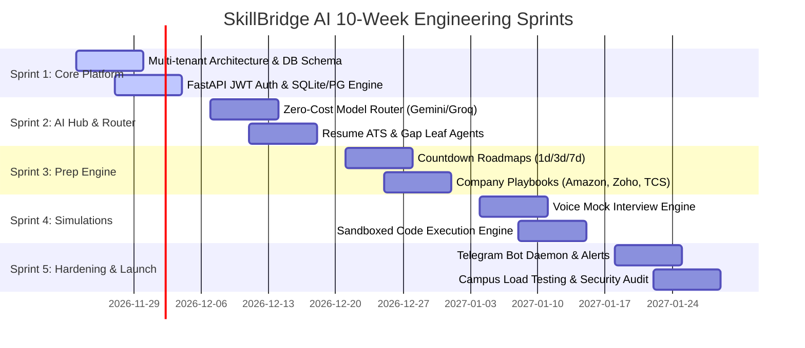

# SkillBridge AI — 10-Week Engineering Roadmap & Delivery Gates

**Document Reference**: `SB-DOC-07`  
**Version**: 1.0.0  
**Methodology**: Agile Scrum (Two-Week Sprints)  
**Total Development Horizon**: 10 Weeks (5 Sprints) to Full Institutional Deployment

---

## 1. High-Level Sprint Timeline

---

## 2. Sprint-by-Sprint Breakdown

### Sprint 1 (Weeks 1–2): Multi-Tenant Core & Identity
- **Goal**: Establish the zero-cost foundation, multi-tenant college schema, and RBAC authentication.
- **Deliverables**:
  - FastAPI modular app structure with SQLModel entities.
  - Multi-tenant tenant extractor dependency (`X-College-Slug` and JWT claims).
  - Next.js 14 UI scaffolding with "Bright Auditorium" Tailwind design tokens.
- **Delivery Gate 1**: Successfully authenticate TPO and Student under separate college slugs (`anna-univ`, `mit-campus`) with 100% data boundary isolation.

### Sprint 2 (Weeks 3–4): Zero-Cost AI Routing & Resume ATS
- **Goal**: Implement dynamic LLM router and leaf agents for ATS resume scoring.
- **Deliverables**:
  - `app/ai/router.py`: Multi-provider fallback across Gemini 1.5 Flash, Groq Llama 3.3, OpenRouter, and local Ollama.
  - `resume_leaf.py`: Semantic resume parser extracting skills, formatting issues, and role fit score (0-100).
  - Student resume upload portal with instant interactive scorecard.
- **Delivery Gate 2**: Resume scoring passes 100 benchmark resumes with $\ge 95\%$ accuracy and fallback to local Ollama on simulated network outage.

### Sprint 3 (Weeks 5–6): Countdown Prep Hub & Company Playbooks
- **Goal**: Deliver the 1-day, 3-day, and 7-day preparation sprints mapped to top recruiters.
- **Deliverables**:
  - Dynamic curriculum generator tailoring questions to company patterns.
  - Curated playbooks for Amazon SDE, TCS Digital, and Zoho Developer.
  - Interactive student countdown checklist with local progress tracking.
- **Delivery Gate 3**: Student can select "Zoho Corp", choose "3-day sprint", and view day-by-day practice tasks with verified LeetCode problem mappings.

### Sprint 4 (Weeks 7–8): Interactive Simulations (Voice & Code)
- **Goal**: Ship the voice-enabled mock interview simulator and in-browser coding sandbox.
- **Deliverables**:
  - Web Speech API voice capture with audio feedback loops.
  - Multi-turn interview agent tracking technical depth and communication cadence.
  - In-browser code runner supporting Python 3 and JavaScript with timeout/memory limits.
- **Delivery Gate 4**: Student conducts a complete 5-question voice interview; receives an instant feedback summary with $< 2\text{s}$ turn latency.

### Sprint 5 (Weeks 9–10): Telegram Bot, Security & Campus Launch
- **Goal**: Deploy institutional Telegram alerts, load-test candidate concurrency, and package deployment guides.
- **Deliverables**:
  - Async Telegram broadcast worker notifying students of new drives.
  - End-to-end security audit (prompt injection defense, sandbox escape prevention).
  - Complete documentation package and single-command local dev scripts (`start_dev.bat`, `start_dev.ps1`).
- **Delivery Gate 5**: System maintains $< 200\text{ms}$ API response under 1,000 simulated student requests during mock drive registration.

