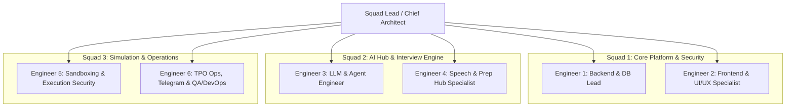

# SkillBridge AI — 6-Member Engineering Squad Work Breakdown (WBS)

**Document Reference**: `SB-DOC-08`  
**Version**: 1.0.0  
**Resource Allocation**: 6 Full-Time Software Engineers (Divided into 3 Agile Squads)

---

## 1. Squad Structure & Ownership

---

## 2. Engineer Responsibilities & Weekly Milestones

### Squad 1: Core Platform, Tenancy & Frontend Experience
#### Engineer 1 (Platform & Data Architect)
- **Primary Ownership**: Multi-tenant database design, SQLAlchemy/SQLModel models, FastAPI gateway, JWT auth & RLS policies.
- **Key Milestones**:
  - W1-W2: Multi-tenant database migration scripts, tenant middleware, user registration and login endpoints.
  - W3-W4: Drive lifecycle APIs, student eligibility filtering, and application status workflows.
  - W9-W10: Database query optimization, connection pooling, and multi-tenant isolation audit.

#### Engineer 2 (Frontend & Design System Lead)
- **Primary Ownership**: Next.js 14 App Router, Tailwind design tokens, student/TPO dashboards, responsive layout.
- **Key Milestones**:
  - W1-W2: "Bright Auditorium" design system components (buttons, badges, modals, typography).
  - W3-W4: Drive discovery feed, resume upload with drag-and-drop, interactive ATS score gauge.
  - W5-W6: 1d/3d/7d Countdown Prep Hub visual timeline and daily study checklist interface.

---

### Squad 2: AI Agents, Router & Interview Engine
#### Engineer 3 (LLM Systems & Multi-Provider Router)
- **Primary Ownership**: `app/ai/router.py`, OpenAI protocol unification, Leaf agent prompt engineering, local Ollama integration.
- **Key Milestones**:
  - W2-W3: Provider failover router (Gemini $\rightarrow$ Groq $\rightarrow$ OpenRouter $\rightarrow$ Ollama).
  - W3-W4: Resume leaf agent (`resume_leaf.py`) and skill gap extraction engine (`gap_leaf.py`).
  - W7-W8: Byte-stable prompt caching and token cost optimization.

#### Engineer 4 (Voice Mock Interview & Speech Specialist)
- **Primary Ownership**: Web Speech API integration, multi-turn interview dialogue state machine, audio playback.
- **Key Milestones**:
  - W5-W6: Interview dialogue orchestrator (`interview_leaf.py`) with adaptive difficulty levels.
  - W7-W8: In-browser speech-to-text audio capture, live transcript display, speech cadence scoring.
  - W9-W10: Voice interview feedback report generation and PDF export.

---

### Squad 3: Sandboxing, Integrations & DevOps
#### Engineer 5 (Execution Sandboxing & Security Specialist)
- **Primary Ownership**: Code execution sandbox, timeout enforcement, memory isolation, algorithm test runner.
- **Key Milestones**:
  - W5-W6: Subprocess and Piston API executor with strict memory limits ($64\text{MB}$) and $4\text{s}$ timeout.
  - W7-W8: Test-case verification engine with hidden test case evaluation and asymptotic complexity analysis.
  - W9-W10: Penetration testing (preventing sandbox escapes, path traversals, and shell injections).

#### Engineer 6 (TPO Operations, Telegram Worker & DevOps)
- **Primary Ownership**: Telegram bot worker, TPO administration portal, automated PyTest suite, CI/CD pipelines.
- **Key Milestones**:
  - W3-W4: TPO candidate shortlist ranking, Excel export, and bulk candidate status updates.
  - W7-W8: Telegram channel daemon broadcasting drive announcements with markdown formatting.
  - W9-W10: End-to-end integration tests, GitHub Actions CI workflow, and zero-cost cloud deployment scripts.

---

## 3. RACI Matrix (Responsible, Accountable, Consulted, Informed)

| Feature / Deliverable | E1 (Platform) | E2 (Frontend) | E3 (AI Lead) | E4 (Voice) | E5 (Sandbox) | E6 (TPO/DevOps) |
| :--- | :---: | :---: | :---: | :---: | :---: | :---: |
| **Multi-Tenant JWT Auth** | **R/A** | C | I | I | I | C |
| **Drive Creation & Matching** | **R** | C | C | I | I | **A** |
| **Zero-Cost Model Router** | C | I | **R/A** | C | I | I |
| **Resume ATS Leaf Agent** | I | C | **R/A** | I | I | C |
| **Countdown Prep Engine** | I | **R** | C | **R** | I | I |
| **Voice Mock Interviewer** | I | C | C | **R/A** | I | I |
| **Sandboxed Code Execution**| I | C | I | I | **R/A** | C |
| **Telegram Broadcast Worker**| C | I | I | I | I | **R/A** |
| **CI/CD & Cloud Deployment** | C | I | I | I | C | **R/A** |

