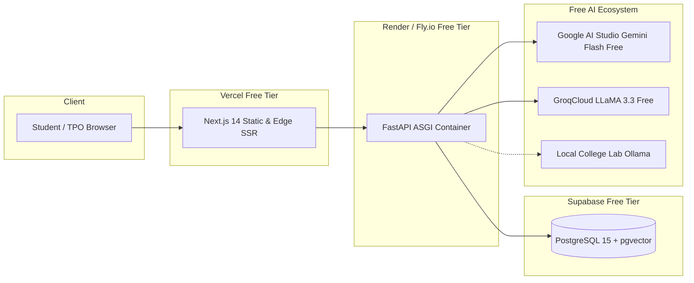

# SkillBridge AI — Testing, Quality Assurance & Zero-Cost Deployment

**Document Reference**: `SB-DOC-10`  
**Version**: 1.0.0  
**Testing Frameworks**: PyTest, HTTPX, Jest, Playwright  
**Target Infrastructure**: 100% Free Tier (Vercel + Render/Fly.io + Supabase Free / Local SQLite)

---

## 1. Testing Strategy & Pyramid

```mermaid
graph TD
    E2E[E2E Tests: Playwright / Browser Flows (10%)]
    INT[Integration Tests: Multi-Tenant API Scenarios (30%)]
    UNIT[Unit Tests: Router, Leaf Agents, Sandbox, Security (60%)]
    
    UNIT --> INT
    INT --> E2E
```

### 1.1 Automated Test Suites
- **Unit & Security Tests**: Fast execution ($< 15\text{s}$) covering JWT parsing, tenant filter validation, sandbox timeout triggers, and prompt sanitizers.
- **API Integration Tests**: Executed against an in-memory SQLite database (`tests/test_api_endpoints.py`), validating drive creation, student matching, countdown prep, and mock interviews.
- **Frontend E2E**: Playwright tests simulating complete student application flow from login to voice mock completion.

---

## 2. Continuous Integration (GitHub Actions)

```yaml
# .github/workflows/ci.yml
name: SkillBridge Quality & Safety Gate

on: [push, pull_request]

jobs:
  backend-test:
    runs-on: ubuntu-latest
    steps:
      - uses: actions/checkout@v4
      - name: Set up Python 3.11
        uses: actions/setup-python@v5
        with:
          python-version: '3.11'
      - name: Install dependencies
        run: |
          pip install -r backend/requirements.txt
          pip install pytest pytest-asyncio httpx
      - name: Run PyTest Suite
        run: |
          cd backend
          pytest tests/test_api_endpoints.py -v

  frontend-build:
    runs-on: ubuntu-latest
    steps:
      - uses: actions/checkout@v4
      - name: Set up Node.js 20
        uses: actions/setup-node@v4
        with:
          node-version: '20'
      - name: Build Next.js Application
        run: |
          cd frontend
          npm install
          npm run build
```

---

## 3. Zero-Cost Production Deployment Architecture

SkillBridge AI is architected to run with **₹0 ongoing hosting bills**:



### 3.1 Deployment Configuration Matrix
| Tier | Host | Spec / Limits | Monthly Cost |
| :--- | :--- | :--- | :--- |
| **Frontend** | Vercel Hobby Tier | Unlimited bandwidth, automatic edge CDN, Next.js optimization | **₹0** |
| **Backend API** | Render / Fly.io | 512MB RAM, sleep-on-idle with fast cold start (or continuous local host) | **₹0** |
| **Database** | Supabase Free / SQLite | 500MB PostgreSQL with pgvector (supports ~50,000 students) | **₹0** |
| **AI LLM Inference**| Google AI Studio / Groq | 15 RPM / 1,500 RPD free tier quotas + local Ollama fallback | **₹0** |
| **DNS & SSL** | Cloudflare Free Tier | DDOS protection, SSL certificates, custom institutional subdomain routing | **₹0** |

