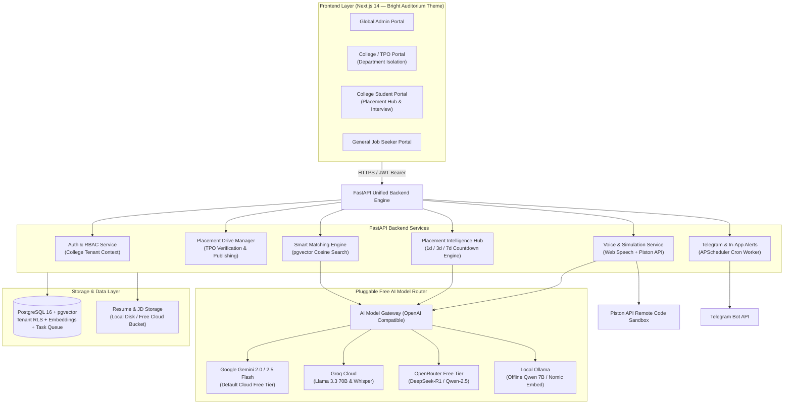
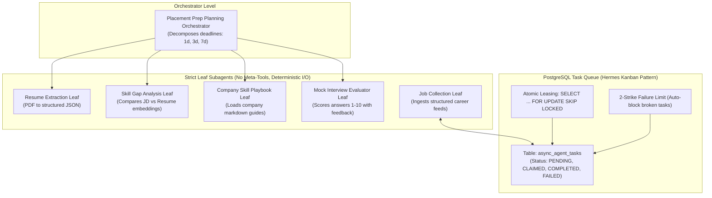
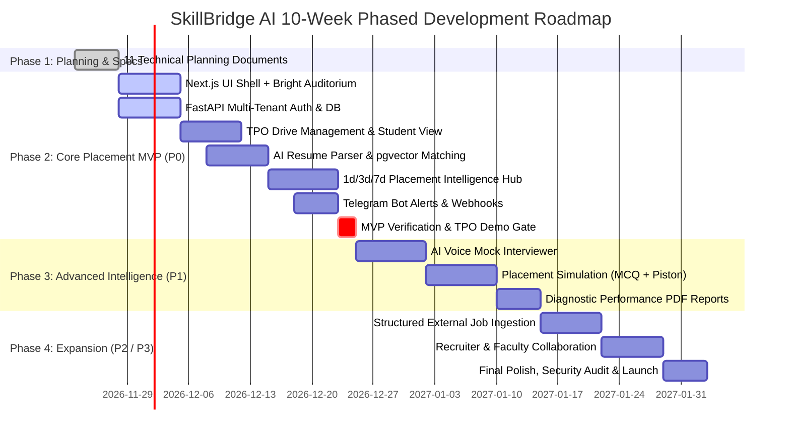
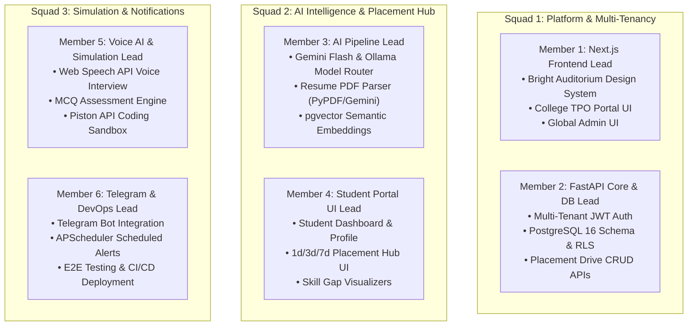

# SKILLBRIDGE AI — MASTER ARCHITECTURAL PLAN
## Production-Ready Blueprint for a 100% Free, AI-Powered Career Guidance & Placement Preparation Platform

---

## 1. Executive Summary & Vision

**SkillBridge AI** is an AI-powered, multi-tenant career guidance, job discovery, and placement preparation ecosystem designed for higher education institutions, engineering college students, placement officers (TPOs), and general job seekers.

### Core Philosophy:
* **"Discover the right opportunity. Build the right skills. Prepare with AI. Achieve your career goals."**
* **100% Free Forever**: Zero paywalls, zero subscriptions, zero payment gateway overhead. Engineered to run completely on high-capacity free cloud tiers and local open-source models at **₹0 operational cost**.
* **Zero Hallucination Guarantee**: Strict verification on all job postings, source attribution, and separation of official company criteria from unverified candidate reviews.

---

## 2. Final Technology Stack Specification

| Component | Selected Technology | Version / Provider | Architectural Justification | Cost Profile |
| :--- | :--- | :--- | :--- | :--- |
| **Frontend** | **Next.js (App Router)** | `v14+` / React 18 | SSR + SPA flexibility, rapid component routing, production build stability. | **₹0 (Free/Open Source)** |
| **UI Design System** | **Tailwind CSS + Shadcn UI** | Latest | **Bright Auditorium Light Mode** (high contrast, crisp slate-50/white, violet/indigo accents). | **₹0** |
| **Icons & Visuals** | **Lucide React + Recharts** | Latest | Clean, minimal visual clutter for student analytics and department stats. | **₹0** |
| **Unified Backend** | **Python FastAPI** | `v3.11+` | Asynchronous high-performance API, native AI/Python ecosystem, Pydantic v2 validation. | **₹0** |
| **ORM / Data Access**| **SQLModel / SQLAlchemy 2.0**| Asyncpg driver | Unified type-safe models for both database tables and API schemas. | **₹0** |
| **Database** | **PostgreSQL 16 + `pgvector`**| PostgreSQL 16 | Single DB for relational multi-tenant data + 768-dim vector embeddings. RLS support. | **₹0 (Free Tier on Supabase/Neon)** |
| **Default Cloud AI** | **Google Gemini 2.0 / 2.5 Flash** | Google AI Studio | 1 Million token context window, sub-second latency, 1,500 requests/day free tier. | **₹0** |
| **Fast Cloud AI** | **Groq Cloud (Llama 3.3 70B)** | Groq API | 500+ tokens/sec ultra-fast inference + Whisper speech-to-text. | **₹0 (Free Tier)** |
| **Free Open Models** | **OpenRouter Free Tier** | OpenRouter API | Access to `deepseek/deepseek-r1:free` and `qwen/qwen-2.5-72b-instruct:free`. | **₹0 (Free Tier)** |
| **Offline / Local AI** | **Ollama** | Localhost:11434 | 100% offline, zero-network private inference (`qwen2.5-coder:7b`, `nomic-embed-text`). | **₹0 (Runs on local hardware)** |
| **Embeddings** | **`text-embedding-004` / Nomic** | Gemini / Ollama | Vector semantic matching for resumes vs job descriptions. | **₹0** |
| **Voice Mock Interview**| **Web Speech API + Gemini Flash**| Browser-native | Real-time browser STT/TTS in Chrome/Edge + Gemini evaluation. | **₹0** |
| **Coding Sandbox** | **Piston API / Judge0 CE** | EngineerMan API | Secure remote compiler & sandbox for 40+ programming languages. | **₹0 (Free Public API)** |
| **Notifications** | **Telegram Bot API** | `python-telegram-bot` | 100% free instant push alerts, interactive buttons, rich markdown. | **₹0** |
| **Scheduler** | **Async APScheduler** | In-Process | Lightweight cron engine for morning/evening drive notification batches. | **₹0** |

---

## 3. System Architecture & Multi-Tenant Design



### Multi-Tenancy & College Isolation
* **Single Database with Discriminator Column (`college_id`)**:
  * Every table (`users`, `students`, `placement_drives`, `applications`, `departments`) carries a mandatory `college_id` foreign key.
  * Multi-tenant isolation is enforced via a FastAPI global dependency (`get_current_tenant_id`) extracted from the cryptographically signed JWT.
  * PostgreSQL Row Level Security (RLS) policies block cross-tenant read/write leaks at the database engine level.
  * One college can **never** view or query another college’s student profiles, placement drive criteria, or interview stats.

---

## 4. Hermes-Inspired Multi-Agent Engine

Drawing from the production-proven architecture of **Nous Research's Hermes Agent**, SkillBridge AI implements four key agentic patterns:



1. **Leaf vs. Orchestrator Hierarchy**:
   * The *Placement Planning Agent* acts as the **Orchestrator** (coordinates steps, evaluates progress, and tailors roadmaps).
   * Resume parsers, scrapers, and coding evaluators are strict **Leaf workers** (forbidden from calling subagents or scheduling background tasks), preventing recursive LLM deadlocks.
2. **Durable Task Queue (`FOR UPDATE SKIP LOCKED`)**:
   * Asynchronous tasks (batch resume parsing, external job ingestion, morning Telegram alerts) are managed in a PostgreSQL task table with atomic row locks. If the backend restarts, zero tasks are dropped.
3. **Company Preparation Skill Playbooks**:
   * Company recruitment patterns (e.g., TCS Digital, Zoho Developer, Amazon SDE, Infosys SP) are stored as modular markdown playbooks (`docs/skills/company_playbooks/*.md`). Agents load only the relevant playbook on-demand, preserving prompt caching.
4. **Byte-Stable Prompt Caching**:
   * Base system instructions are byte-identical across turns. Dynamic content (student answers, scorecards) is passed as alternating tool results to maximize Google Gemini's context cache.

---

## 5. Portal Breakdown & Key Workflows

### Portal 1: Global Admin Portal
* **Purpose**: Ecosystem oversight and data management.
* **Capabilities**:
  * Manage onboarded colleges, branches, and academic years.
  * Monitor external job collection feeds (API status, ingestion counts).
  * Run duplicate detection and stale job pruning.
  * System-wide health analytics and AI latency diagnostics.

### Portal 2: College / TPO Portal (Isolated Environment)
* **Purpose**: Department-specific placement management for College TPOs and Placement Staff.
* **Capabilities**:
  * **Placement Drive Creator**: Publish on-campus / off-campus drives with strict eligibility filters (CGPA $\ge X$, Max Arrears $\le Y$, allowed branches).
  * **Student Readiness Dashboard**: View real-time readiness scores, resume ATS ratings, and practice assessment completion rates.
  * **One-Click Telegram Broadcast**: Push approved drives directly to eligible students' Telegram inboxes.
  * **Department Analytics**: Track placement conversion rates across CSE, IT, ECE, Mechanical, Civil, etc.

### Portal 3: College Student Portal (The Core Innovation)
* **Purpose**: Personalized AI career guidance and intensive placement preparation.
* **Core Modules**:
  1. **AI Resume Parser & ATS Scorer**: Instant PDF extraction of skills, projects, and work experience.
  2. **Smart Job & Drive Matching**: Semantic match score against upcoming campus drives.
  3. **AI Placement Intelligence Hub**:
     * Student inputs company name, role, and countdown date (e.g., *Drive in 1 day*, *3 days*, or *7 days*).
     * System generates an adaptive, time-boxed preparation roadmap:
       * **1-Day Sprint**: High-frequency revision, company cheat sheet, top 10 probable questions.
       * **3-Day Sprint**: Core technical revision, aptitude practice, 1 mock interview.
       * **7-Day Sprint**: Deep conceptual prep, daily coding practice, full mock cycle.
  4. **AI Voice Interviewer**: Browser-based interactive mock interview. AI speaks questions, student replies via microphone; AI delivers instant technical accuracy and communication scores.
  5. **Placement Simulation Mode**: End-to-end full drive dry-run (Aptitude MCQs $\rightarrow$ Technical MCQs $\rightarrow$ Piston Coding Sandbox $\rightarrow$ HR Voice Round $\rightarrow$ Comprehensive Diagnostic PDF).
  6. **Telegram Bot Integration**: Daily morning/evening notifications for upcoming deadlines and newly eligible drives.

### Portal 4: General Job Seeker Portal
* **Purpose**: Independent graduates and professionals looking for off-campus opportunities.
* **Capabilities**:
  * Upload resume, set role/location preferences.
  * Match against verified public job feeds (Greenhouse, Lever, RemoteOK, Jooble).
  * Personal AI preparation hub for off-campus interviews.

---

## 6. Phased Implementation Roadmap (P0 to P3)



### Feature Priority Definition:
* **P0 (Must-Have for Demo & College Pilot)**:
  * Multi-tenant college setup (TPO, Student, Department).
  * TPO Drive creation with CGPA/branch criteria.
  * Student resume upload, PDF extraction, and ATS scoring.
  * Semantic eligibility matching via `pgvector`.
  * Placement Intelligence Hub with 1d/3d/7d countdown generator.
  * Instant Telegram bot notifications for approved drives.
* **P1 (Core AI Differentiators)**:
  * Voice Mock Interviewer with Web Speech API + Gemini Flash.
  * Placement Simulation Mode with Piston API coding sandbox.
  * Candidate Weakness Diagnostic Report.
* **P2 (Advanced Integrations)**:
  * Structured job feed ingestion (Greenhouse, Lever, RemoteOK APIs).
  * Local Ollama offline toggle for zero-internet environments.
* **P3 (Future Expansions)**:
  * Company Recruiter self-service portal.
  * Faculty Development Programs & research collaboration.

---

## 7. Rebalanced 6-Member Team Squad Model



### Responsibility Matrix:
| Member | Role | Primary Tech | Deliverables |
| :--- | :--- | :--- | :--- |
| **Member 1** | Frontend Architect | Next.js, Tailwind, Shadcn | Design system, TPO Drive Manager UI, Admin Dashboard, Student Table. |
| **Member 2** | Backend Architect | FastAPI, PostgreSQL, SQLModel | Multi-tenant auth middleware, PostgreSQL migrations, Drive APIs, Tenant RLS. |
| **Member 3** | AI Engineer (Core) | Python, Gemini API, Groq, Ollama | Model Router, Resume PDF parser, Embedding generation, Semantic search. |
| **Member 4** | Fullstack Feature Dev | Next.js, FastAPI, Recharts | Student Portal, Countdown Prep UI, Dynamic Roadmaps, Skill Gap charts. |
| **Member 5** | AI Engineer (Interview) | Web Speech API, Piston API | Voice Mock Interviewer, Timed Simulation Engine, Compiler integration. |
| **Member 6** | DevOps & Integrations | Python, Telegram API, GitHub Actions | Telegram Bot, Cron scheduler, Postman/PyTest test suites, Deployment setup. |

---

## 8. Master Index of the 11 Planning Deliverables

The complete documentation suite will be maintained in `d:\Xcoder\Job-Portal\docs\`:

```
d:\Xcoder\Job-Portal\docs\
├── 01_PRD.md                             # Product Requirements Document (Full functional/non-functional specs)
├── 02_System_Architecture.md             # System Architecture, Micro-boundaries, Sequence Diagrams
├── 03_Database_Design.md                 # PostgreSQL 16 ERD, Tables, Foreign Keys, pgvector, RLS Policies
├── 04_API_Design.md                      # OpenAPI / REST Endpoints, Payloads, Error Contracts
├── 05_AI_Agent_Design.md                 # Orchestrator & Leaf Workflows, Prompts, Free Model Router
├── 06_UI_UX_Design_System.md             # Bright Auditorium Style Guide, Sitemaps, Wireframe Layouts
├── 07_Development_Roadmap.md             # 10-Week Sprint Plan, Deliverables, Completion Gates
├── 08_Team_Work_Breakdown.md             # Detailed WBS & GitHub Task Cards for Members 1 through 6
├── 09_Security_and_Risk_Plan.md          # Multi-Tenant Data Isolation, API Security, Rate Limiting
├── 10_Testing_and_Deployment_Plan.md     # PyTest, Playwright, Postman Collections, Free Cloud Deployment
└── 11_Feature_Prioritization_Matrix.md   # MoSCoW Prioritization (P0 MVP vs P1/P2/P3 Justifications)
```

---

## 9. Final Decision & Execution Approval

* **Architecture Model**: 100% Free, Unified FastAPI Backend, Next.js 14 Frontend, PostgreSQL + pgvector, Pluggable Free AI Router (Gemini Flash, Groq, OpenRouter, Local Ollama).
* **Guiding Principles**: Zero-hallucination job verification, strict college multi-tenancy, zero audio server latency, and sandboxed remote code execution.

This document represents the final, confirmed development blueprint for SkillBridge AI.
